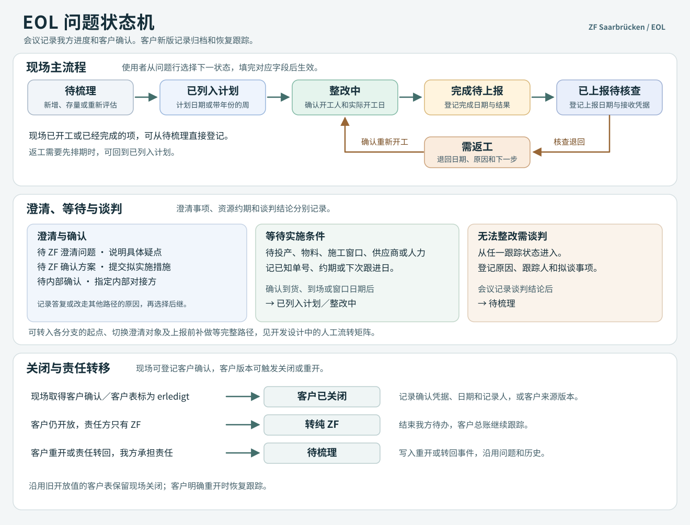

# ZF Saarbrücken EOL 问题管理系统开发设计

设计基线 1.3 · 2026 年 11 月 25 日 · 适用范围为 Windows x64 单机、测试线 EOL。项目根目录为 `OPL`。首版采用 Python、Flask、SQLite 和中文浏览器界面。现场会议决定我方进度，客户 Excel 提供客户事实。周报按问题的状态事件和期末存量分别统计。本文确定业务规则、界面、交付方式和验收条件。

## 1　工作簿与核对基准

| 数据来源 | 读取位置 | 导入职责 |
|---|---|---|
| 客户 2026-11-18 版 | `EOL/List/ZF/` 中的 `List of defects`，表头第 10 行 | 客户编号、提出日期、工位、作者、Department、Category、优先级、Problem、Action、Responsible、Due Date、客户状态及其变更人和日期 |
| 豪森补充版 | `EOL/List/Haosen/ZF SBR CT & LOP plan_V0_Richard_28102026.xlsm` 的 `End of Line `，实际页名带尾部空格 | 问题和行动译文、M–P 准备资料与负责人、Q 分类提示、R 现场备注。读取单元格及已存公式值，按去空格、忽略大小写的工作表名识别 |
| 豪森双语清单 | `EOL/List/Haosen/测试线问题清单.xlsx` 的 `End of Line (2)` | 补齐译文、负责人、备注以及覆盖范围更广的历史问题。此模板的 Q 是备注。新版宏工作簿的 Q 是分类码 |
| 状态、工位与附件 | `doc/state_machine.xlsx` 的 `Sheet1!A1:D8`、`EOL/Station/`、`EOL/Feedback/` | 状态草案、HVL 工位字典及别名、路线图、按问题编号保存的 JPG、MP4 和文本反馈 |

11 月 18 日客户表有 **1,236 个问题行**。815 个已关闭，421 个客户未关闭，其中 18 个纯 ZF、13 个豪森与 ZF 共同负责，390 个纯豪森。我方默认跟踪 **403 个**。每个源问题行分别计数，实物工位用工位字典统一。

| 区域 | 我方未结 | High（含 High+） | Medium | Low（含空值） |
|---|---:|---:|---:|---:|
| S1 | 237 | 53 | 115 | 69 |
| S2 | 86 | 9 | 40 | 37 |
| General | 80 | 27 | 37 | 16 |
| 合计 | **403** | **89** | **192** | **122** |

豪森新工作簿有 **1,183 个问题行**，其中 1,182 行的编号为数字，另有一行编号为 `#REF!`。按规范化工位、提出日期、作者和译文前的原文做一次严格的双向唯一匹配，**1,026 行**找到唯一客户行，其中 **198 行**的编号不同或损坏。其余 **157 行**需要其他证据，包括已知别名、历史绑定、原始全文或人工核对。宏表的最高有效数字编号为 1360，旧双语表为 1391，客户表为 1406。宏表补充现场信息时按字段取用，各版的客户覆盖范围由各自快照确定。

Q 列实际有 61 条标记。1“问题不清晰，需与 ZF 澄清”有 12 条，2“已有措施，需 ZF 确认”有 14 条，3“内部确认”有 25 条，4“待投产”有 10 条。表头还定义了 5“无计划”，本表填入该码的行数为 0。宏表第 673 行的 Q 为 2，现场备注却是“问题不明确，需要与 ZF 讨论”。导入预览同时展示分类提示和备注，由会议确认初始状态。空白 Q 保持未知。

## 2　状态机与现场操作

表格只设一列 **我方状态**。`offen`、`in Arbeit`、`erledigt` 存在客户快照中，可在问题详情的“客户版本”里核查。`state_machine.xlsx` 的 D 列用于解释常见对应关系。客户从 `offen` 改成 `in Arbeit` 只更新客户字段，会议仍可把该项留在“待 ZF 澄清问题”。

### 2.1　人工流转矩阵

**待梳理**是一个内部状态。首次建立基线的存量显示“存量待梳理”，后续新客户行显示“新问题点”，重开或谈判返回显示“待梳理”并注明进入原因。下表的“澄清组”指三个可单独筛选的实际状态。每个在跟踪状态还可进入“无法整改需谈判”，谈判状态本身可追加进展。

| 当前我方状态 | 现场可选的下一状态 |
|---|---|
| 待梳理 | 已列入计划、整改中、完成待上报、澄清组、等待实施条件 |
| 待 ZF 澄清问题 | 待梳理、已列入计划、整改中、完成待上报、另两种澄清状态、等待实施条件 |
| 待 ZF 确认方案 | 待梳理、已列入计划、整改中、完成待上报、另两种澄清状态、等待实施条件 |
| 待内部确认 | 待梳理、已列入计划、整改中、完成待上报、另两种澄清状态、等待实施条件 |
| 等待实施条件 | 已列入计划、整改中、澄清组 |
| 已列入计划 | 整改中、完成待上报、澄清组、等待实施条件 |
| 整改中 | 完成待上报、澄清组、等待实施条件 |
| 完成待上报 | 已上报待核查、整改中（上报前发现需补做） |
| 已上报待核查 | 需返工（核查退回） |
| 需返工 | 已列入计划、整改中、澄清组、等待实施条件 |
| 无法整改需谈判 | 待梳理（记录谈判结论后重新评估） |
| 转纯 ZF | 持客户凭据可登记“客户已关闭”；客户重新分配给我方时恢复跟踪 |
| 客户已关闭 | 客户明确重开时恢复跟踪，见 2.3 |

相对原状态表，把“已列入计划／整改中”拆为两步，便于追踪真实开工日。把核查退回细分为“需返工”和“整改中”，便于列出退回后尚未开工的项。同一场会议中确定已开始返工时，可连续确认“退回”和“开工”，分别保存两个事件。矩阵中 11 个跟踪状态均可从待梳理到达，也都有继续上报的路径。上述所有尚未关闭的状态均可在取得客户确认后转入“客户已关闭”，包括转纯 ZF 的问题。

### 2.2　切换条件与日期

用户点击行内状态，弹窗仅列当前可达的目标。弹窗展示原状态、目标、必填内容及生效日期，默认日期是柏林当天，允许补录实际日期。保存人来自当前操作者，我方负责人可与其不同。取消弹窗不产生记录。服务端与界面共用同一份流转矩阵和校验规则。

| 目标或动作 | 必填内容与生效规则 |
|---|---|
| 发起／切换澄清 | 填负责人、要解决的具体问题和对接对象。ZF 澄清记录待解释的问题或验收要求，ZF 确认方案记录方案版本或内容，内部确认记录需哪一方判定。可登记提问日、答复日及内容。退出澄清时记录答复或改走其他路径的原因 |
| 等待实施条件 | 选择待投产、物料、停线／停电窗口、供应商或人力，填负责人和阻碍。已下单物料记录单号和预计到货日。尚待投产或交期未定时保存已知资料、缺项及下次跟进日。窗口、到场或人力已有约期则填日期，未定则填下次确认日。返回排期或开工前登记已确认的到货、到场或窗口日期 |
| 已列入计划 | 负责人、下一步行动、计划日期或带年份的 ISO 周。只给周时保存周精度。调整计划保留新旧安排。同状态改期写计划事件 |
| 整改中 | 会议确认执行人、实际开始日期与行动。待梳理项可直接开工。上报前退回补做时另填原因 |
| 完成待上报 | 实际完成日期、整改结果、负责人。可关联图片、视频、报告。会议确认现场已经完成的项可从待梳理直接进入 |
| 已上报待核查 | 使用者确认已对外上报，填上报日期及接收人或可追溯的反馈凭据。客户同意预实施方案只完成方案确认。完成后的上报单独登记 |
| 需返工 | 核查退回日期、退回原因和下一步行动。收到客户确认，可按下一行登记关闭 |
| 客户已关闭 | 填写记录人、客户确认日期及可追溯的确认凭据。系统记录现场确认关闭事件；客户表原始状态仍随来源版本保存 |
| 无法整改需谈判 | 技术或商务原因、负责人和拟谈事项。结束谈判登记日期、结论和下一步。记录转回待梳理的原因 |
| 普通反馈 | 操作人、反馈日期、内容，可附多张图片、视频、文件。更新反馈日期，保留最近一次状态变化日期 |

每个状态事件保存问题 ID、前后状态、实际发生日、系统录入时间、操作人或来源批次、原因和关联凭据。同日多次变化按该问题的事件序号还原。内部进度以事件顺序维持合法流转。补录比上一状态更早的事实可作为历史反馈。确需更正时间线时保存更正事件并重新校验前后顺序。计划日、客户截止日、实际完成日、上报日分别保存。

### 2.3　客户版本触发的流转

1. 生效客户行的状态为 `erledigt`，进入“客户已关闭”。责任同时变为纯 ZF 时，以客户关闭作为此次状态事件，责任变化另记字段历史。
2. 客户仍开放且规范化后的责任方集合恰为 `{ZF}`，进入“转纯 ZF”。这会结束我方待办，客户总账继续把它列为未关闭。
3. “客户已关闭”重新开放且我方承担责任，或“转纯 ZF”重新分给豪森／共同责任时，回到“待梳理”，标明“客户重开”或“责任转回”。纯 ZF 项后续被客户关闭可从“转纯 ZF”进入“客户已关闭”。已关闭项重开后仍为纯 ZF，则进入“转纯 ZF”。
4. 现场已凭据关闭的问题遇到仍沿用旧开放状态的客户表，会保留现场判定。后续客户表也标为已关闭时只更新来源字段。若客户在确认日后明确更改开放状态或给出新的开放状态日期，按生效版本恢复跟踪。
5. 新版状态相同只保存有变化的客户字段。空责任、陌生状态、消失行和匹配歧义进入待核队列，保留上次有效判断。首次出现且责任空白的有效未结问题保留在我方视图并标待核。已经关闭和纯 ZF 的初始存量直接归档，初始化单独记账。
6. 有可信业务日期则保存原值及依据。没有对应日期时显示“首次在某版观察到”，周统计按版本观察日期归档并标注。客户表末尾的状态日期不能直接充当我方开工、上报或责任转移日期。

## 3　编号、版本导入和逐条行动

**客户编号和内部 ID。** 问题有永久内部 ID。列表用客户编号。在某编号首次出现重复时，按该客户基线的行序一次性分配 `1405a`、`1405b` 等。新增同号项领取下一个后缀，超过 z 使用 aa、ab。排序、漏行、关闭、再次导入都沿用已分配后缀。原单号后来变成重号时保留旧号别名。搜索无后缀号码展示该组全部记录，旧详情链接和附件始终指向内部 ID。客户重新编号另存别名与生效版本。

**匹配与复核。** 先使用已确认的来源绑定，再用工位、日期、作者和问题原文交叉验证，对重号及编号冲突检查双方的候选唯一性。对文本修订、工位别名、缺描述、同号多工位和错误公式，展示原行、候选客户行和匹配依据。现场确认的一对一绑定供后续版本复用。无法确认的记录可暂存待核。豪森宏表第 1193 行的 `#REF!`、旧双语表第 1181 行的 `1347`，对应 11 月 18 日客户表第 193 行的 **75**。另一例是宏表第 1133 行的 `1298` 对应客户第 410 行的 **467**。附件文件名只提供候选，重号需选具体工位。

**问题关系。** “主问题—明细”为有向关系，可展开全部下级明细并定位原问题，保存时防止自指和成环。“重复”“相似”为双向关系。关系独立保存两端问题 ID、关系类型、建立人、日期、依据和确认情况。界面可从候选中确认或手动建立、解除关系，变更留痕。详情分别列出明细、重复和相似项，注明自身状态与工位。关闭、转责、重新开放只作用于选中的内部 ID。组合浏览、同号展示和关系链接均不改变统计件数。

**导入流程。** 页面选取一个或多个文件，亦可由同一 Python 导入入口扫描指定目录。识别产线、来源模板、工作表和表头后，先预览新增、客户字段更新、关闭、转责、缺失、歧义和待翻译。用文件指纹识别重导，用客户业务版本排序。同日不同内容允许登记修订顺序。确认后在一个数据库事务中提交已匹配变更、原始快照、待核队列及状态事件。失败回滚。旧版只作历史对照。来源不明的行保留待核。豪森历史资料按字段补充，已有现场确认的负责人、译文、进度及附件若有冲突则并排显示差异。

**Action 时间线。** 每条问题拥有一组独立更新。每条含源文本、译文、来源版本、原顺序、日期原文、解析日期、作者（可空）及修订关系。按段首或已验证的更新边界识别 `17.01.2025`、`11/12/2026` 等日期，续行归入上一段。正文引用的交期保留在段内。歧义月日、缺年和未注明日期的文字均保留原文与位置，允许人工确认或拆并。相同日期可有多条行动。同一条行动的原文和译文成对展示。重复版本复用已有行动，客户修改或删除一段时保留旧版。原始单元格完整保存，便于核对拆分。行动文字可提示状态，正式上报和返工仍由使用者登记。

**翻译。** 复用已确认译文和工位术语表，对新旧文字按片段比较，只排队翻译新增或变化的 Problem／Action。保存原语言、原文指纹、译文、来源和人工确认记录。英文与中文并排。德文来源保存德文，可补中、英两栏。可选 OpenAI Responses API 用 Python 标准库 HTTPS 调用，密钥由本机环境提供，模型可配置。离线或 API 失败时，保留导入和人工处理能力，待译任务可重试。[OpenAI Responses API](https://developers.openai.com/api/reference/resources/responses/methods/create)

## 4　两页中文界面

### 4.1　概览页

以 `Europe/Berlin` 的当前时间打开德国 ISO 周，支持切换年份和周。2026-CW48 的范围是 11 月 23 日周一至 11 月 29 日周日。查询边界取当地周一零时及下周一零时。

1. **本周状态更新。** 顶部按统计截止日的最后一次状态变更归类，每条本周变更的问题只计入其最终状态。状态变更记录仍逐笔展示整周历史。往下逐项列出编号、工位、原状态 → 新状态、生效日、负责人和本次反馈。旁边可查看截至所选时点仍需澄清、确认、整改或上报的清单。点击数字打开相同条件的问题表。
2. **本周计划。** 两栏均支持滚轮、拖动滚动条和键盘浏览完整记录。实施计划合并计划日期／周落在本周的问题，以及截至统计日最新状态变化为本周进入整改中的问题；同一问题只列一次，显示计划动作、工位、责任人、准备信息、当前结果及客户截止日。支持查看改期记录和当周计划中至今尚未上报的项。
3. **测试线整体情况。** 显示当前我方未结、客户未结、较上周末净增减、本周新增和重开。按 S1／S2／General 和工位展开数量及优先级。本周新增、责任转入、客户关闭和转纯 ZF 各列单独计算。与上周末使用相同筛选范围，净减少量取上周末存量减本期末存量，增加时显示净增加。无上周可信基线显示“缺上周基线”。

### 4.2　问题表和详情

表头固定，左侧固定客户号和工位。宽屏以“中文问题｜客户原文”对照，行高随文字展开。窄屏在同一问题内按“中文、原文”上下排列。收起时保留最新反馈摘要、日期及展开入口。详情可打开完整行动时间线、附件、关系、状态历史和原始客户版本。

| 列组 | 展示内容 |
|---|---|
| 定位 | 客户号及后缀、工位英文名、八位机器号、AVO、区域 |
| 问题与责任 | 双语 Problem。客户 Department › Category 放在一起，我方负责人相邻显示。客户 Responsible 单独识别组织责任，支持多名我方负责人 |
| 我方状态与反馈 | 一列可切换的我方状态、状态更新日、最新双语行动／现场反馈及日期、负责人 |
| 时间对照 | 客户 Due Date 与我方计划日／周并排，实际完成、上报和核查日期在详情按事件展开 |
| 准备信息 | 整改人数与工种、原表“整改时间”、投产单号，可展开多个单号或日期。旧表 O 列既有日期也有自由文字，经确认后才作为承诺计划或实际完成日 |
| 附件与关系 | 图片缩略图、视频或报告入口、明细／重复／相似项数量，点击打开具体问题 |

客户 `Remark`、`Step 1`、`Step 2` 存入快照，主表省略。豪森自己的“备注”承载现场反馈，逐条保留并注明来源。工位字典保存客户写法、机器号和 AVO 的映射，AVO 可对应多个实际工位，辊道和电柜也可能共用机器号。按已确认的工位规则，二期包括 CTA5/6 辊道和电柜、Leakage Test 2-1/2-2、Oil Filling 2、HV 2、Testbench 3/4、Flash and Blowout 设备号尾 `1104/1105/1106` 和 Unrigging 2。AGV 按设备末四位划入 S1／S2，含 General 的归 General，其余按既定规则归 S1，未确认的别名带待核标记。客户表 Step 列独立留存。

客户提出者可用 Tobias Gleser、Andreas Feber 等姓名多选。工位、机器号、AVO、区域、客户部门／类别、客户责任方、ZF-related、我方负责人、我方状态和优先级均支持同维多选、跨维交集。勾选框默认反映当前范围的全部值。可全选、取消全选、只选空值或搜索匹配。搜索栏可用英文或中文逗号输入多个客户编号，匹配稳定编号和历史别名。裸号包含所有同号后缀，带后缀精确匹配。客户编号按数值及重号后缀排序。“恢复默认筛选”回到我方未结全表。“全部客户记录”含归档。默认排除客户已关闭及纯 ZF，保留共同责任。沿用旧周报口径的 ZF-related 指纯 ZF。“所有 ZF 参与”包括纯 ZF 和共同责任。筛选后工位统计使用同一批问题 ID，支持点击统计数查看明细。

工位仍统一显示 AGV。机器号 24821220 归 S1、24821221 归 S2，未标明的 AGV 默认 S1。区域在读取历史或当前快照时计算，旧数据库可直接使用。需要定位具体设备时按机器号筛选。客户提出者 Tobias 与我方负责人分别归属各自维度。

**现场派工单。** 清单可按相同条件及编号顺序导出 A4 黑白 PDF 或 Excel，支持横竖方向。默认五栏打印，依次为编号及类别、设备号及工位名称、问题描述、近期行动、跟进信息。最右栏集中呈现状态、负责人和计划，按需追加明细／主问题、重复或相似问题的客户编号以及投产单号。正文优先中文，缺译文时保留原文。中英对照版分七栏展示，以便核查技术表述。近期行动比较最新客户行动和现场记录的业务日期，保留原始日期不明的标记。长文自动换行或续页，详细历史及证据由问题详情保存。

### 4.3　周筛选和周报口径

| 用户要看的问题 | 查询定义 |
|---|---|
| CW48 哪些被列入计划、已上报、被退回 | “期间发生过”查询当周进入指定状态的事件。当周先上报再退回的同一问题可分别出现在两组。组内按问题 ID 去重，展开后显示全部事件 |
| 最新一次状态更新在 CW48 | 在指定截止时点，对每条问题先取最近一次有效状态事件，再筛它的日期和目标状态。普通备注或补照片只影响反馈时间 |
| 哪些还没上报或还没澄清 | “截至所选日”重建状态。已完成未上报选“完成待上报”。全部待澄清用三个澄清状态，可再按对接方区分。“本周计划中尚未上报”按该轮整改自计划／返工后是否已登记上报计算，另显示当时状态 |
| 哪些安排在 CW48 实施 | 取本周排期与截至统计日最近一次在本周进入整改中的问题并集。CW47 排进 CW48 实施的项属于 CW48 计划，其“列入计划”事件属于 CW47 |
| 周报和净变化 | 本周默认截至当前时点，历史周截至周末。周报显示新增问题、重开／责任转入、我方范围流出、客户正式关闭及期末存量。同一条“先转纯 ZF、后客户关闭”在客户关闭栏计一次、在我方存量仅流出一次。初始化单独列作基线。补录的业务日期和记录日期均可追溯 |

节拍整改和安全检测共用问题、工位、责任人及附件。节拍任务记录目标秒数、变更前后实测值、测量条件及复测日期。安全任务记录检查对象、发现项、报告和复验结论。周报任务可登记编写人、截止日、出稿／确认时间，按周从同一事件记录生成中文汇总及可复制的双语明细。单独的任务及其关联不会增加 OPL 问题件数。

## 5　数据库与技术交付

**文件布局。** 主库为 `OPL/data/opl.sqlite3`。当前各产线保留各自的 `List`、`Station`、`Feedback` 目录。程序与数据间的路径均相对项目根目录解析。附件索引记录相对路径、内容指纹、名称、反馈日期和关联 ID，一份证据可服务多条独立问题。备份包含 SQLite 一致性快照、附件及源文件版本。恢复时校验文件对应关系。

| 数据对象 | 关键字段与约束 |
|---|---|
| 工位、别名、问题、编号历史 | 产线、内部 ID、规范工位、原始工位、机器号、AVO、客户原号、稳定后缀、版本生效范围 |
| 导入批次、原始快照、匹配绑定 | 来源、业务版本／修订、文件指纹、工作表、行号、原始字段、客户状态及责任方、前后差异和匹配依据 |
| 我方状态与事件、计划历史 | 当前状态及修订号。追加式事件保存前后值、生效日、录入时间、来源、操作者。状态、日期和主表修订在同一事务提交 |
| 行动、反馈、译文与证据 | 每条行动／反馈有独立 ID，保留双语内容、日期精度、原始片段和修订。关联附件并保留人工确认译文 |
| 负责人、准备信息、专项任务、问题关系 | 多人、工种／人数、原始整改时间、投产单。专项指标／周报任务。关系类型、方向、证据及确认记录 |

一个本机 Python 进程通过 Waitress 监听 `127.0.0.1`，Flask／Jinja2 提供页面，浏览器使用原生 HTML、CSS、JavaScript。桌面浏览器即可完成筛选、行内表单、图片／视频查看及周报打印。SQLite 通过标准库访问。按产线、工位、状态、事件日期及计划周建立索引。每次写入校验问题修订号，两窗口同时编辑时提示更新差异。导入批次保持幂等，升级数据库前备份并以事务执行迁移。应用静态资源随项目分发，日常使用可断网。[Flask 在 Windows 使用 Waitress](https://flask.palletsprojects.com/en/stable/deploying/waitress/) · [SQLite 应用文件](https://www.sqlite.org/appfileformat.html)

### 5.1　Windows x64 版本基线

以下为首版选定的完整运行依赖。12 个第三方包已用 pip 对官方 PyPI 做 Windows x64、CPython 3.14 的联合解析预检，全部有匹配的二进制发布包。CPython 采用常规 64 位构建。SQLite 版本取自该 CPython 标签的 Windows 构建清单。发布验收打印实际引擎版本并与清单核对。

| 层 | 精确版本 |
|---|---|
| 解释器、安装工具、数据库 | CPython **3.14.9**，随发行版的 pip **26.2.2**，SQLite **3.50.4** |
| 直接运行库 | Flask **3.1.3**、Waitress **3.0.2**、openpyxl **3.1.5**、tzdata **2026.2** |
| Web 模板与 HTTP 依赖 | Werkzeug **3.1.8**、Jinja2 **3.1.6**、MarkupSafe **3.0.3**、itsdangerous **2.2.0** |
| Web 命令行、通知与 Windows 依赖 | click **8.3.1**、blinker **1.9.0**、colorama **0.4.6** |
| Excel XML 依赖 | et-xmlfile **2.0.0** |

`sqlite3`、`venv`、`datetime`、`zoneinfo`、`json`、`urllib.request`、`ssl`、`hashlib`、`webbrowser`、`unittest` 等标准库随 CPython 同版。前端原生组件和可选翻译 HTTPS 调用均无额外第三方运行库。Windows 使用 tzdata 解析柏林时区和夏令时。[CPython 3.14.9 Windows 发行页](https://www.python.org/downloads/release/python-3149/) · [SQLite 构建版本](https://github.com/python/cpython/blob/v3.14.9/PCbuild/get_externals.bat) · [pip 构建版本](https://github.com/python/cpython/blob/v3.14.9/Lib/ensurepip/__init__.py) · [Flask 依赖声明](https://github.com/pallets/flask/blob/3.1.3/pyproject.toml) · [MarkupSafe Windows 轮子](https://pypi.org/project/MarkupSafe/3.0.3/) · [openpyxl](https://pypi.org/project/openpyxl/3.1.5/) · [Waitress](https://pypi.org/project/waitress/3.0.2/) · [tzdata](https://pypi.org/project/tzdata/2026.2/)

### 5.2　一键启动与 GitHub 维护

首版交付方式选 **一键创建 venv**。从 GitHub 下载或克隆项目到可写目录，双击根目录 `启动 OPL.cmd`。启动器用自身位置定位根目录，检测指定 CPython x64，缺失时使用随发布包提供或从官方获取、经校验的当前用户安装程序。自动建立 `.venv`，从含版本及 SHA-256 的 `requirements.lock` 安装全部依赖，完成数据库初始化／迁移、启动服务并打开默认浏览器。后续启动复用环境与既有数据。若端口被占用，识别已有本应用实例并复用。其他程序占用时另选本地端口。[Python 官方 Windows 安装选项](https://docs.python.org/3.14/using/windows.html#installing-without-ui)

GitHub 仓库维护源码、模板、静态资源、迁移、锁文件、启动器、设计和脱敏测试样本。实际客户／豪森表、设备资料、附件、数据库及其 WAL／SHM、备份、密钥和个人环境属于现场数据，由忽略规则处理。发布包可随附官方解释器安装程序和锁定的 Windows wheels，使用同一入口在离线电脑安装。环境重建可重复执行。恢复或升级保留用户数据。发布门槛为一台未预装开发工具的 Windows x64 电脑完整走通首次安装、二次启动、离线使用和版本升级。

## 6　验收场景

| 场景 | 通过条件 |
|---|---|
| 客户基线与工位汇总 | 1,236 个问题行、421 个客户未关闭、403 个我方待跟踪。区域和优先级与第 1 节一致。Oil Filling 2 与 `24821062` 合计 23 条，High 2、Medium 11、Low 10 |
| 版本与编号 | `1405a` 涂脂站和 `1405b` NVH 罩装配站分别保留。交换 Excel 行序、重复导入、补历史版本后仍能打开原记录。关闭其中一条，另一条继续独立跟踪 |
| 豪森字段迁移 | 页名尾部空格能识别。Q 分类与 R 备注冲突时显示双方证据。`#REF!` 对应客户 75 的历史可核对。宏表第 655 行缺 Problem 仍进入匹配流程 |
| 现场流转 | 仅有 `offen → in Arbeit` 时我方状态保持原值。用户从行内菜单登记开工和上报。缺必填项不能提交。撤销、重试、并发窗口均不产生重记或静默覆盖 |
| 澄清、等待、谈判 | 三种确认分别能查询、登记答复及退出。有施工窗口但缺料、待投产而暂无订单、谈判后返回评估等场景均有可追溯的下一步 |
| 核查、返工、自动关闭 | 提交 → 退回 → 需返工 → 整改中 → 完成待上报 → 再上报可反复。客户 `erledigt` 与转纯 ZF 分栏统计，重开保留全部历史 |
| 周别及时点 | 同一问题 CW47 排进 CW48、CW48 上报又退回，当周计划、进入过各状态、截至周末待返工及最新变化四种查询各自返回正确结果。跨年 ISO 周、补录、无期初快照均能解释 |
| 行动、关系与证据 | 多种日期、无日期、同日两条、段中交期、重复双语及修改旧段的 Action 能回到原始单元格。多级明细、相似／重复链接和多图可展开，各问题持有独立状态 |
| 一键交付 | 在含中文及空格的目录完成首次配置，断网再启动后可筛选、记反馈、查周报。恢复备份能打开附件。翻译无额度时导入成功，待译项可重试 |

实现顺序为工位字典与导入核对 → 稳定编号和 SQLite 历史 → 现场状态机与问题表 → 概览、专项任务及周报 → 一键发行验收。第二份正式 ZF 客户快照可用于验收真实版本差异。开工时可先用脱敏样例覆盖关闭、转责、返工和重开。
